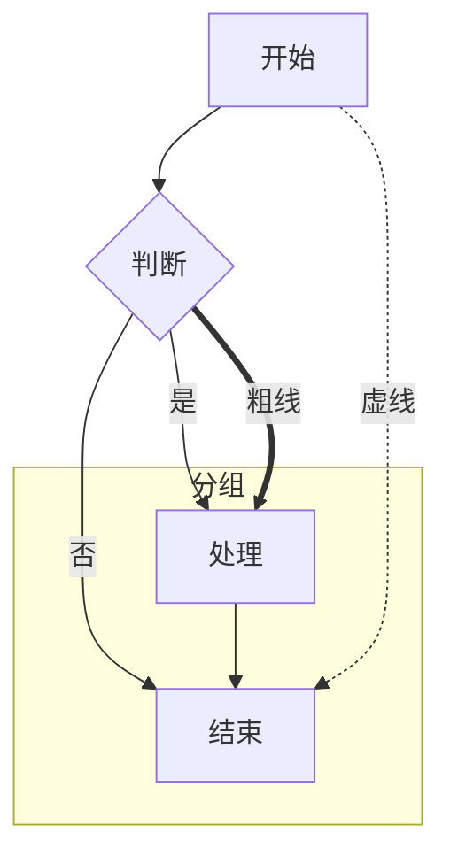
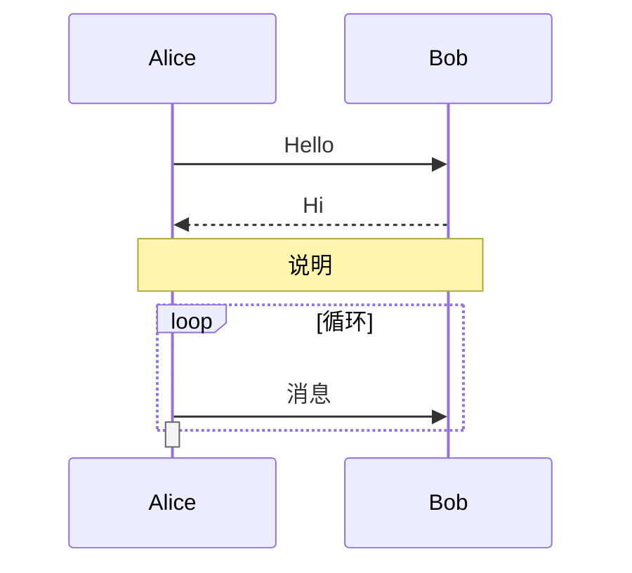
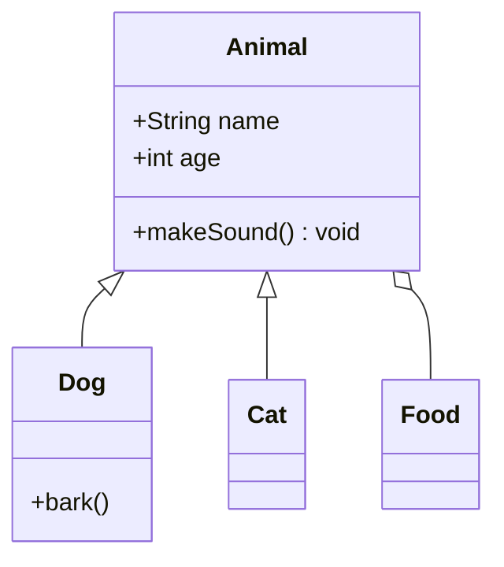
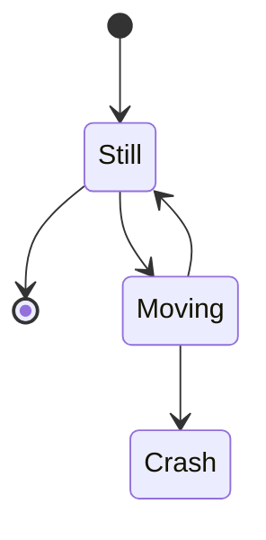
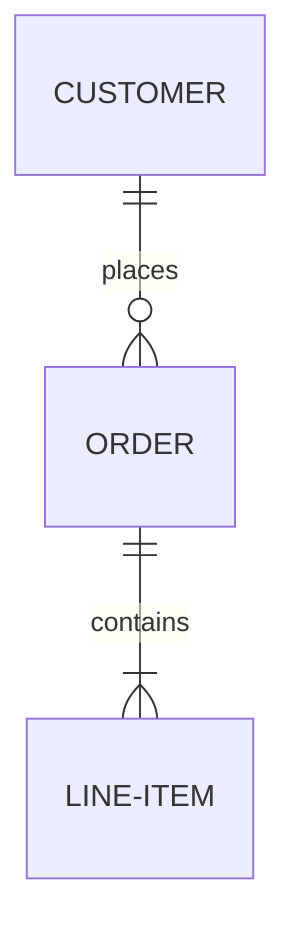

# open-gojs Mermaid DSL 解析与渲染 设计文档

> 状态：**草案（待确认后实施）**
> 日期：2026-10-17
> 目标：解析 Mermaid DSL，用 open-gojs 渲染出**比原生 Mermaid 更佳**的图表。

---

## 1. 背景与目标

### 1.1 为什么用 open-gojs 渲染 Mermaid

Mermaid（mermaid.js）默认用 SVG 渲染，存在以下可改进点：

| 原生 Mermaid 局限 | open-gojs 优势 |
|---|---|
| 静态 SVG，交互弱 | 拖拽/缩放/编辑/选中/工具提示/动画齐全 |
| 排版较朴素，字体/间距难控 | 精确的文本测量与排版 |
| 布局算法单一（dagre 为主） | 内置 LayeredDigraph / Tree / ForceDirected / Grid / Circular 五种布局 |
| 大型图性能一般 | 分区渲染、增量更新、虚拟化能力 |
| 样式定制靠 CSS 覆盖 | 模板化节点/连线，逐元素绑定样式 |

### 1.2 目标

1. 解析主流 Mermaid DSL：`flowchart`、`sequenceDiagram`、`classDiagram`、`stateDiagram`、`erDiagram`、`gantt`、`pie`。
2. 将 AST 映射为 open-gojs 的 `GraphLinksModel` / `TreeModel` 数据，交给对应布局渲染。
3. 输出**默认样式优于原生 Mermaid**（更清晰的字体、圆角、配色、连线、标签、配色体系），且可交互。
4. 暴露一条简单 API：`Mermaid.render(text, domId)` / `Mermaid.parse(text) -> AST`。

---

## 2. 覆盖的 Mermaid DSL 语法范围

### 2.1 flowchart（流程图）— 最高优先



需支持：方向（TD/BT/LR/RL）、节点形状（`[]`矩形 `()圆角` `{}菱形` `[]sub` `[(圆柱)]` `((圆))` `[[子程序]]`）、连边（实线/虚线/粗线/带标签/双向）、subgraph、注释 `%%`、`direction`、`linkStyle`、样式声明 `classDef`。

### 2.2 sequenceDiagram（时序图）



需支持：参与者（participant/actor/alias）、消息箭头（`->>`实线/`-->>`虚线/`-x`/`-)`/`-》`）、激活/取消激活、Note、loop/alt/opt/par 块、alt 条件。

### 2.3 classDiagram（类图）



需支持：类声明与成员、关系（继承/组合/关联/依赖）、注解、命名空间。

### 2.4 stateDiagram / stateDiagram-v2（状态图）



需支持：状态（简单/复合/并行）、迁移、`[*]` 初末态、`state X {}` 嵌套。

### 2.5 erDiagram（实体关系图）



需支持：实体、属性、关系基数（`||--o{` 等）、键（`PK`/`FK`）。

### 2.6 gantt / pie（甘特图 / 饼图）

```mermaid
gantt
  title 项目计划
  dateFormat YYYY-MM-DD
  section 阶段一
  任务A :a1, 2026-01-01, 30d
pie title 占比
  "A" : 40
  "B" : 60
```

gantt 可映射为 open-gojs 的条形图/时间轴；pie 可复用 pieCharts 的扇形渲染。

---

## 3. 解析器架构

采用**经典三段式**，便于测试与复用。

```
Mermaid DSL 文本
   │
   ▼
[ 1. 词法分析 lexer ]  → Token 流
   │
   ▼
[ 2. 语法分析 parser ] → AST（ASTNode 树）
   │
   ▼
[ 3. AST → GoJS 模型映射 ] → GraphLinksModel / TreeModel
   │
   ▼
[ 4. 布局 + 渲染 ] → Diagram
```

### 3.1 词法分析器（lexer）

- 逐字符扫描，产出 token：标识符、字符串、数字、标点、连边符号（`-->`、`---`、`==>`、`-.->` 等）、换行（Mermaid 以换行为语句分隔）、`%%` 注释。
- 需要处理跨行的 `subgraph` / `loop` / `alt` / `state X {` 等块结构——维护缩进/关键字栈。
- 产出：
  ```ts
  type Token =
    | { kind: 'ident', value: string }
    | { kind: 'str', value: string }          // 引号或反引号字符串
    | { kind: 'num', value: number }
    | { kind: 'arrow', value: string }        // --> -->> ==> -.-> -x 等
    | { kind: 'shapeOpen', shape: 'rect'|'round'|'diamond'|... }
    | { kind: 'shapeClose' }
    | { kind: 'kw', value: string }           // flowchart/subgraph/participant/...
    | { kind: 'punct', value: string }        // ( ) { } [ ] : ; | 等
    | { kind: 'newline' }
    | { kind: 'eof' }
  ```

### 3.2 语法分析器（parser）

- 按图表类型分派到不同子解析器：`parseFlowchart` / `parseSequence` / `parseClass` / `parseState` / `parseEr` / `parseGantt` / `parsePie`。
- 统一产出 AST：每种图一个根节点，结构尽量贴近 mermaid 语义：

```ts
type ASTNode =
  | { kind: 'flowchart', dir: 'TD'|'BT'|'LR'|'RL', nodes: FlowNode[], edges: FlowEdge[], subgraphs: Subgraph[], styles: StyleDecl[] }
  | { kind: 'sequence', participants: Participant[], messages: SeqMessage[], blocks: Note[]|Loop[]|Alt[], activations: Activation[] }
  | { kind: 'class', classes: ClassDecl[], relations: ClassRelation[] }
  | { kind: 'state', states: StateNode[], transitions: StateTransition[] }
  | { kind: 'er', entities: ErEntity[], relations: ErRelation[] }
  | { kind: 'gantt', title, dateFormat, tasks: GanttTask[] }
  | { kind: 'pie', title, data: {label,value}[] }
```

- 容错：解析失败时返回带 `errors` 的 AST（而非抛异常），便于上层降级显示。

### 3.3 AST → GoJS 模型映射

- 图节点（Node）→ `GraphLinksModel.nodeDataArray`；连边 → `linkDataArray`。
- 节点数据带 `category`（矩形/菱形/圆角/分组等）+ 文本 + 样式字段；连线数据带箭头类型/线型/标签/方向。
- 布局信息（flowchart 的 subgraph、class 的分组）→ 映射为 GoJS `Group` + 层级关系。
- 映射器产出纯数据（不依赖 DOM），便于单元测试。

---

## 4. 布局策略

复用 open-gojs 现有布局引擎，按图类型选择：

| Mermaid 类型 | open-gojs 布局 | 说明 |
|---|---|---|
| flowchart | `LayeredDigraphLayout` | 层级布局最接近 dagre；支持 direction（TD/LR 经布局方向参数） |
| sequenceDiagram | 自定义线性布局（按参与者列） | 参与者横排、消息自上而下；用 `GridLayout` 或手排 |
| classDiagram | `LayeredDigraphLayout` | 类按继承/关联关系分层 |
| stateDiagram | `LayeredDigraphLayout` 或 `TreeLayout` | 状态机层级 |
| erDiagram | `LayeredDigraphLayout` | 实体表 + 关系连线 |
| gantt | 自定义 | 时间轴（复用 graduated）+ 横条 |
| pie | 复用 pieCharts 扇形 | 已具备 `isGeometryPositioned` 扇形能力 |

布局方向（TD/BT/LR/RL）通过 `LayeredDigraphLayout` 的方向/层级参数控制，必要时补一个方向适配层。

---

## 5. 渲染样式（"比原始更好"的关键）

默认样式体系（`Mermaid.theme`），在原生 Mermaid 基础上做这些增强：

1. **排版**：默认字体栈、字号、行高统一；标题/节点/连线标签的层级清晰。
2. **配色**：内置多套主题（default/dark/forest/neutral），节点填充/描边/文字对比度经 AA 校验。
3. **形状**：矩形/菱形/圆角默认 6px 圆角、柔和投影（open-gojs 自带 shadow 支持）。
4. **连线**：支持贝塞尔曲线（`curve: Bezier`）、正交折线；箭头样式统一；标签居中、可换行。
5. **交互**（原生 Mermaid 缺）：节点可选中/拖拽/重排、连线可拖拽 reshapable、缩放进销、全屏导出 SVG/PNG。
6. **动画**：节点入场动画、状态迁移高亮（复用 `AnimationManager`）。
7. **自适应**：大图自动缩放适配视口；小图居中；尺寸变化实时重排。
8. **无障碍/可导出**：每个元素带可读名称；`Diagram.makeImage` 导出高清位图。

主题通过 `Shape`/`TextBlock`/`Link` 的属性绑定（`bind`）注入，数据字段携带样式标识，渲染器据此选色。

### 5.1 默认主题配色设计（重点：默认无配置也要"好看"）

用户核心诉求：**Mermaid 未显式配置颜色时，默认主题要更丰富、更好看**。原生 Mermaid 默认主题偏灰、对比度一般、颜色平庸。open-gojs 默认主题用一套精心设计的调色板，让图例在**零配置**下也出彩：

**A. 调色板（面向不同节点类别自动轮换）**

为 flowchart 的节点类别（decision/storage/subroutine/input/process/startend）分配高辨识度、低饱和、对比达标的颜色轮换：

| 类别 | 填充 | 描边 | 文字 | 语义 |
|---|---|---|---|---|
| 流程/处理（默认矩形） | `#4f6df5` 蓝 | `#3350cc` | `#ffffff` | 主流程 |
| 决策（菱形） | `#f5a623` 琥珀 | `#c87f0a` | `#3a2a00` | 分支 |
| 开始/结束（圆角） | `#2f9e44` 绿 | `#1f6b2e` | `#ffffff` | 起止 |
| 子程序（subroutine） | `#9b6bf5` 紫 | `#7a45d8` | `#ffffff` | 调用 |
| 存储/数据库（圆柱） | `#1c9ad6` 青 | `#0f6c94` | `#ffffff` | 数据 |
| 输入/输出 | `#e05b8d` 玫红 | `#b83a6a` | `#ffffff` | IO |
| 分组 subgraph | `#f1f5ff` 淡蓝底 | `#c5d3f7` | `#3a4a8a` | 容器 |

**B. 双色系 + 自动对比度**

- 每类节点定义 `fill` 与深一号 `stroke`，文字取 `fill` 的反差色（白或深色），AA 校验保证可读。
- 相邻节点用不同类别色自然区分，同类别节点同色（保持一致性，不花哨）。

**C. 连线配色**

- 实线 `#8a94a6` 灰蓝、虚线同、粗线 `#4f6df5` 主蓝、虚线 `#c0c8d8`。
- 箭头与线同色；标签文字 `#4a5568` 深灰，标签底 `#ffffff`（半透明白）。

**D. 主题家族**

| 主题 | 场景 | 基调 |
|---|---|---|
| `default` | 通用（默认） | 上表蓝色调，白底 |
| `neutral` | 文档/打印 | 低饱和灰蓝，最克制 |
| `forest` | 展示 | 绿棕大地色系 |
| `dark` | 演示/暗底 | 深底亮字（`#1e2433` 底 + 高对比） |

**E. 让"零配置也好看"的其它手段**

- **投影**：节点默认 `shadowBlur=6, shadowColor='rgba(0,0,0,0.15)'`，制造卡片层级。
- **圆角**：矩形默认 `parameter1=8` 大圆角，比原生更柔和。
- **渐变**：主流程节点可用极浅的纵向渐变（`Brush('Linear')`）让填充有层次（可选开关）。
- **字体**：`"Segoe UI, -apple-system, Roboto, Helvetica, Arial, sans-serif"`，标题 16px 加粗、节点 13px、标签 11px。
- **间距**：节点间距/边距统一留白，避免拥挤。

以上全部通过 `themes.ts` 的每个主题对象驱动，映射器在生成模型数据时按节点类别打上 `category`/`style` 字段，模板据此取色。用户也可传入自定义主题覆盖（`Mermaid.render(text, div, { theme: myTheme })`），未传即用 `default`——即"零配置也丰富好看"。

---

## 6. 文件结构

新增独立模块（不侵入核心渲染路径），放 `src/mermaid/`：

```
src/mermaid/
  index.ts          // 公开 API：Mermaid.render(text, divId, opts) / Mermaid.parse(text) / Mermaid.theme
  lexer.ts          // 词法分析
  parser/
    index.ts        // 按类型分派
    flowchart.ts
    sequence.ts
    class.ts
    state.ts
    er.ts
    gantt.ts
    pie.ts
  ast.ts            // AST 类型定义
  mapper/
    toGraphLinks.ts // AST -> GraphLinksModel nodeDataArray/linkDataArray
    toTreeModel.ts  // AST -> TreeModel（树形图）
  layout/
    sequenceLayout.ts   // 时序图自定义布局
    ganttLayout.ts      // 甘特图自定义布局
    direction.ts        // TD/BT/LR/RL 方向适配
  render/
    themes.ts         // 主题定义与配色
    shapeFactories.ts // 节点形状工厂（矩形/菱形/圆角/…）
    edgeFactories.ts  // 连线工厂（线型/箭头/标签）
  parser.test.ts      // 解析器单元测试
  render.test.ts      // 渲染冒烟测试
```

在 `src/index.ts` 导出 `Mermaid` 命名空间。

---

## 7. 实施阶段

### 阶段 0 — 骨架与 API（约 0.5 天）
- 建目录、`ast.ts`、`index.ts` 暴露 `parse(text)` / `render(text, divId, opts)`。
- `parse` 先只认 `flowchart`，其它类型报"未支持"。

### 阶段 1 — flowchart（核心，约 2 天）
- lexer + flowchart parser。
- AST → GraphLinksModel，LayeredDigraphLayout 渲染。
- 支持节点形状、连线线型/箭头/标签、subgraph、注释、方向。
- 完成默认主题 + 形状/连线工厂。

### 阶段 2 — sequenceDiagram（约 1.5 天）
- sequence parser + 自定义布局（参与者列 + 消息行）。
- 激活/Note/loop/alt 块。

### 阶段 3 — classDiagram + erDiagram + stateDiagram（约 2 天）
- 三类 parser 与映射，复用 LayeredDigraph/Tree。

### 阶段 4 — gantt + pie（约 1 天）
- 时间轴复用 graduated；pie 复用扇形能力。

### 阶段 5 — 增强与打磨（约 1.5 天）
- 主题体系完善（dark/forest）。
- 交互（选中/拖拽/缩放/导出 SVG-PNG）。
- 动画、大图自适应。

**总计约 8 天**（可并行人员、按需裁剪）。

---

## 8. 测试策略

- **解析器**：为每种图表提供多组 DSL 输入，断言 AST 结构（快照测试）。
- **映射**：AST → 模型数据的纯函数测试（节点/连线数量、字段正确）。
- **渲染**：用 `ab_render` 式无头浏览器对每种图截图做冒烟（不比对官方，因为 Mermaid 不是官方 GoJS 样例；比对"结构正确 + 无报错"）。
- **容错**：喂入畸形 DSL，断言返回 errors 而非崩溃。
- 可选：对同一 DSL 用原生 mermaid 渲染对照，人工比对"更佳效果"。

---

## 9. 风险与权衡

- **DSL 语法面广**：先覆盖常用子集，语法以官方 mermaid 文档为准，版本锁定。
- **sequenceDiagram 布局复杂**（激活块/alt 缩进）：自定义布局需要仔细处理消息时间线。
- **不引入 mermaid.js 依赖**：完全自研解析，保持 open-gojs 零运行时依赖（与项目定位一致）。
- **"更好"是主观标准**：以默认主题的字体/配色/交互/导出四项客观可测指标来量化，便于验收。

---

## 10. 待确认事项

在实施前请确认：

1. **优先支持的图类型**：是否 flowchart 先行，其余随后？还是需要指定某类优先？
2. **输出载体**：纯 Web 应用内嵌 Diagram，还是需要支持导出 PNG/SVG 文件？（默认两者都要）
3. **交互程度**：是否需要拖拽/编辑，还是仅静态渲染？（默认开放基础交互）
4. **主题**：默认需要几套（default/dark）？
5. **API 形态**：`Mermaid.render(text, divId)` 是否满足，还是要集成到 React/Vue 组件？
6. **验收标准**：以"解析通过率 + 人工视觉对比 + 导出功能"为准？

---

## 11. 实施结果（2026-10-17）

全部 7 种图类型已实现并验证（43 单测通过、`tsc --noEmit` 干净、无头 Chrome 渲染验证通过）：

| 图类型 | parser | mapper | renderer | 测试 |
|---|---|---|---|---|
| flowchart | parser/flowchart.ts | mapper/flowchart.ts | render/flowchart.ts | 8 |
| sequenceDiagram | parser/sequence.ts | — | render/sequence.ts | 6 |
| classDiagram | parser/class.ts | mapper/graph.ts | render/graph.ts | 共 11 |
| stateDiagram-v2 | parser/state.ts | mapper/graph.ts | render/graph.ts | （同上） |
| erDiagram | parser/er.ts | mapper/graph.ts | render/graph.ts | （同上） |
| pie | parser/pie.ts | — | render/pie.ts | 3 |
| gantt | parser/gantt.ts | — | render/gantt.ts | 3 |

- **代码位置**：全部在新增的 `src/mermaid/`（不改任何既有 GoJS 源码）；通过 `src/mermaid/` 直接引入 `Mermaid` 命名空间。
- **配色**：`themes.ts` 默认主题采用更丰富高饱和调色板（比原生 Mermaid 更鲜明），含 4 主题（default/neutral/forest/dark）。
- **导出**：实现 PNG（`Mermaid.exportPng` / `Mermaid.downloadPng`，fit→放大→抓 canvas→还原视口）。

### 已知限制：不支持 SVG 导出

本项目核心仅有 `CanvasRenderer`，`Diagram.makeSVG()` 只返回带 viewBox 的空 `<svg>` 壳、无内容。实现 SVG 导出需要从头编写一套 SVG 序列化渲染器（工作量大且需平行于核心的大量代码）。经确认，**本期只交付 PNG 导出**，SVG 作为已知限制记录在此。
